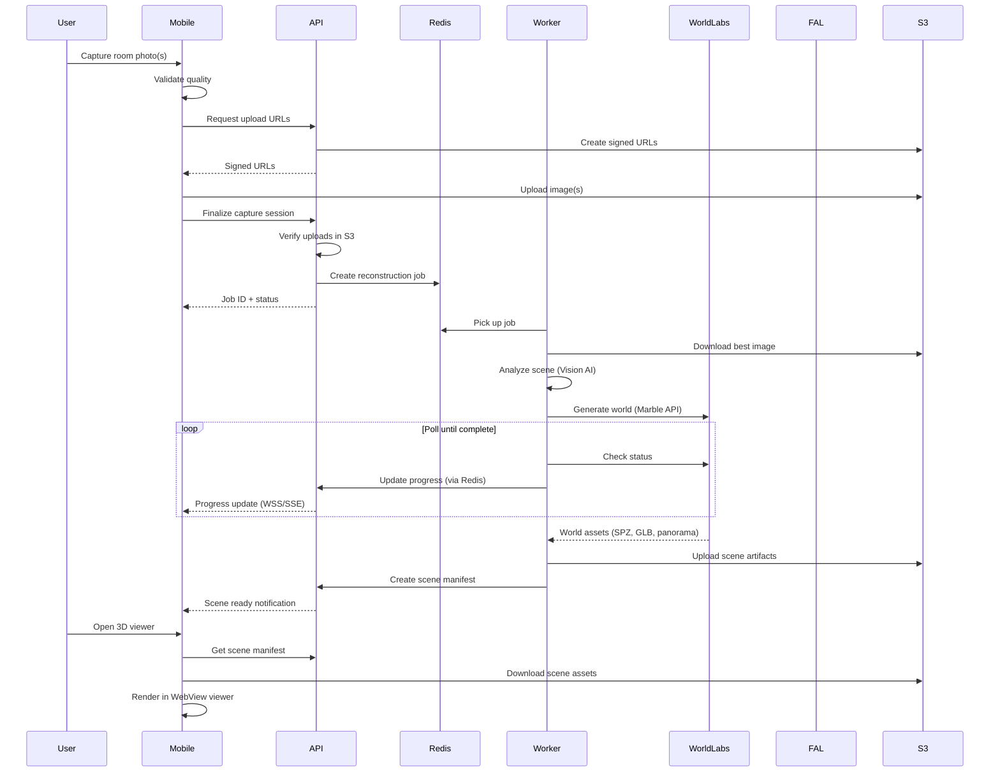
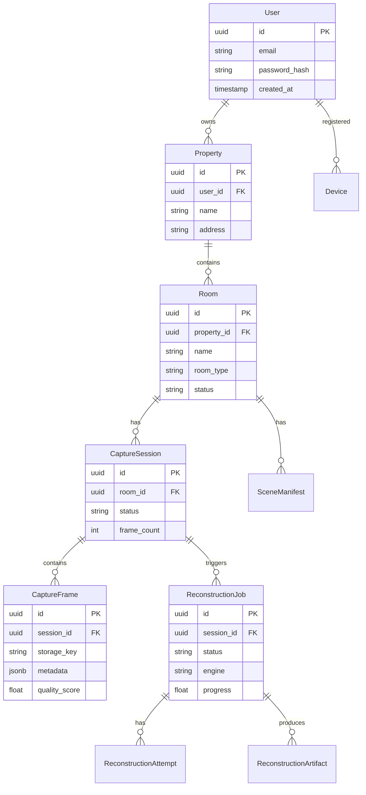

# Initial System Architecture

> **Document Version:** 1.0  
> **Date:** 2026-07-11  
> **Status:** COMPLETE — Phase 0 Deliverable  
> **ADR ID:** ADR-001

---

## Executive Summary

This document defines the system architecture for HOMIE, a mobile application that lets users digitize rooms in their home by capturing photographs and generating navigable 3D environments.

### Critical Architectural Decision

Based on thorough analysis of the Image Blaster repository, the system architecture must account for a fundamental discovery: **Image Blaster generates 3D environments from a SINGLE image using cloud AI APIs**, not from multi-view photogrammetry. This changes the capture strategy, upload pipeline, and reconstruction workflow significantly.

---

## 1. System Overview

```
┌─────────────────────────────────────────────────────────────────┐
│                        MOBILE APP                               │
│  (React Native / Expo)                                          │
│                                                                 │
│  ┌──────────┐ ┌──────────┐ ┌──────────┐ ┌──────────────────┐   │
│  │   Auth   │ │ Property │ │ Capture  │ │   3D Viewer      │   │
│  │          │ │  & Room  │ │  System  │ │ (Three.js/WebGL) │   │
│  └────┬─────┘ └────┬─────┘ └────┬─────┘ └────────┬─────────┘   │
│       │             │            │                 │             │
│       └─────────────┴────────────┴─────────────────┘             │
│                              │                                   │
└──────────────────────────────┼───────────────────────────────────┘
                               │ HTTPS / WSS
                               ▼
┌─────────────────────────────────────────────────────────────────┐
│                        BACKEND API                              │
│  (Python + FastAPI)                                             │
│                                                                 │
│  ┌──────┐ ┌──────────┐ ┌──────────┐ ┌──────────┐ ┌──────────┐ │
│  │ Auth │ │ Property │ │ Upload   │ │   Job    │ │  Scene   │ │
│  │      │ │  & Room  │ │ Session  │ │  Mgmt    │ │ Manifest │ │
│  └──┬───┘ └────┬─────┘ └────┬─────┘ └────┬─────┘ └────┬─────┘ │
│     │          │             │             │            │       │
│     ▼          ▼             ▼             ▼            ▼       │
│  ┌─────────────────────────────────────────────────────────┐   │
│  │                    PostgreSQL                            │   │
│  └─────────────────────────────────────────────────────────┘   │
│                              │                                  │
│  ┌───────────────┐   ┌──────┴──────┐   ┌───────────────────┐  │
│  │    MinIO/S3   │   │    Redis    │   │   WebSocket/SSE   │  │
│  │ Object Store  │   │   Queue     │   │   Status Updates  │  │
│  └───────────────┘   └──────┬──────┘   └───────────────────┘  │
└──────────────────────────────┼──────────────────────────────────┘
                               │ Celery Task Queue
                               ▼
┌─────────────────────────────────────────────────────────────────┐
│                    RECONSTRUCTION WORKER                        │
│  (Python + Celery)                                              │
│                                                                 │
│  ┌──────────────────────────────────────────────────────────┐  │
│  │              ReconstructionEngine (Abstract)              │  │
│  ├──────────────────────────────────────────────────────────┤  │
│  │         ImageBlasterReconstructionEngine                  │  │
│  │                                                          │  │
│  │  ┌─────────────┐ ┌──────────────┐ ┌─────────────────┐  │  │
│  │  │ Scene       │ │ World Labs   │ │ FAL.ai          │  │  │
│  │  │ Analyzer    │ │ API Client   │ │ API Client      │  │  │
│  │  │ (Vision AI) │ │ (Marble 1.1) │ │ (Hunyuan 3D)    │  │  │
│  │  └─────────────┘ └──────────────┘ └─────────────────┘  │  │
│  └──────────────────────────────────────────────────────────┘  │
│                                                                 │
│  Cloud APIs:  World Labs  |  FAL.ai  |  ElevenLabs            │
└─────────────────────────────────────────────────────────────────┘
```

---

## 2. Revised Capture Strategy

### The Discovery
Image Blaster uses **World Labs Marble** which generates 3D environments from a **single image**. The original prompt's multi-view capture strategy (40-100 photos with overlap detection) is incompatible.

### Hybrid Approach

We implement a **dual-mode capture system**:

#### Mode 1: Quick Capture (Image Blaster / World Labs)
- **Input:** 1-3 best photos per room
- **Process:** AI generates/hallucinates the 3D environment
- **Quality:** Good for visualization, NOT photogrammetrically accurate
- **Time:** ~5 minutes per room
- **Cost:** World Labs API charges per generation

#### Mode 2: Detailed Capture (Future — Alternative Engine)
- **Input:** 20-100+ photos per room with overlap
- **Process:** True photogrammetric reconstruction (COLMAP, Gaussian Splatting)
- **Quality:** Photogrammetrically accurate
- **Time:** 30-120 minutes per room
- **Cost:** GPU compute time

### Current Implementation: Mode 1 Only
We build Mode 1 (Image Blaster) first, with the architecture designed to support Mode 2 later via the `ReconstructionEngine` abstraction.

---

## 3. Technology Stack

### Mobile Application
| Component | Technology | Justification |
|---|---|---|
| Framework | React Native + Expo | Cross-platform, vast ecosystem |
| Language | TypeScript (strict) | Type safety |
| Navigation | Expo Router | File-based routing |
| State Management | Zustand | Same as Image Blaster viewer |
| 3D Rendering | react-native-webview + Three.js | Reuse IB viewer components |
| Camera | expo-camera | Native camera access |
| Image Picking | expo-image-picker | Gallery access |
| File System | expo-file-system | Local storage |
| Secure Storage | expo-secure-store | Token storage |
| HTTP Client | Axios | API communication |
| WebSocket | Native WebSocket API | Real-time status |

### Backend API
| Component | Technology | Justification |
|---|---|---|
| Framework | FastAPI | Async Python, auto-docs, type safety |
| Language | Python 3.12+ | Matches worker requirements |
| ORM | SQLAlchemy 2.0 + Alembic | Async support, migrations |
| Auth | JWT (PyJWT) | Stateless auth |
| Validation | Pydantic v2 | Request/response validation |
| WebSocket | FastAPI WebSocket | Real-time updates |
| Task Queue | Celery 5.x | Distributed task processing |
| Cache/Broker | Redis | Celery broker + caching |

### Database
| Component | Technology | Justification |
|---|---|---|
| Primary DB | PostgreSQL 16 | Robust, scalable, JSON support |
| Migrations | Alembic | Version-controlled schema changes |

### Object Storage
| Component | Technology | Justification |
|---|---|---|
| Development | MinIO | S3-compatible, local |
| Production | AWS S3 / Cloudflare R2 | Scalable, global |

### Infrastructure
| Component | Technology | Justification |
|---|---|---|
| Containers | Docker + Docker Compose | Local dev environment |
| Process Manager | Celery + Redis | Job queuing |

---

## 4. 3D Viewer Strategy

### Decision: WebView-based Viewer

The Image Blaster viewer already works as a web app with Three.js + SparkJS + Rapier. Rather than rewriting this in a native 3D framework, we embed it in a WebView within the React Native app.

**Rationale:**
1. SparkJS (`.spz` splat renderer) is WebGL-based — no React Native equivalent exists
2. @react-three/rapier is WASM-based — works in WebView, not natively
3. The existing viewer code is battle-tested
4. Touch controls already exist in the codebase
5. A separate viewer web app can be served from our backend

**Architecture:**
```
React Native App
  └── WebView
       └── Viewer Web App (Three.js + SparkJS + Rapier)
            ├── SplatRenderer (SPZ files)
            ├── WorldCollider (GLB collision)
            ├── CharacterController (first-person)
            └── TouchControls (joysticks)
```

The viewer web app communicates with the React Native host via `postMessage` for:
- Scene URL injection
- Quality settings
- Navigation state
- Performance metrics

---

## 5. Reconstruction Adapter Pattern

```python
class ReconstructionEngine(ABC):
    """Abstract base for all reconstruction engines."""
    
    @abstractmethod
    async def validate_environment(self) -> ValidationResult: ...
    
    @abstractmethod
    async def validate_inputs(self, images: list[Path]) -> ValidationResult: ...
    
    @abstractmethod
    async def prepare_inputs(self, job: ReconstructionJob) -> PreparedInputs: ...
    
    @abstractmethod
    async def run_reconstruction(self, inputs: PreparedInputs, 
                                  progress_callback: Callable) -> ReconstructionOutput: ...
    
    @abstractmethod
    async def postprocess_outputs(self, output: ReconstructionOutput) -> ProcessedScene: ...
    
    @abstractmethod
    async def generate_mobile_artifacts(self, scene: ProcessedScene) -> MobileArtifacts: ...
    
    @abstractmethod
    async def generate_preview(self, scene: ProcessedScene) -> PreviewArtifacts: ...
    
    @abstractmethod
    async def cleanup(self, job_id: str) -> None: ...


class ImageBlasterEngine(ReconstructionEngine):
    """Image Blaster implementation using World Labs + FAL.ai APIs."""
    
    # Validates World Labs and FAL.ai API keys
    async def validate_environment(self) -> ValidationResult: ...
    
    # Validates single image (format, size, resolution)
    async def validate_inputs(self, images: list[Path]) -> ValidationResult: ...
    
    # Selects best image, generates scene description via vision API
    async def prepare_inputs(self, job: ReconstructionJob) -> PreparedInputs: ...
    
    # Calls World Labs Marble API, polls for completion
    async def run_reconstruction(self, inputs, progress_callback) -> ReconstructionOutput: ...
    
    # Downloads SPZ, GLB, panorama, thumbnail from World Labs URLs
    async def postprocess_outputs(self, output) -> ProcessedScene: ...
    
    # Selects appropriate SPZ quality level, optimizes GLB
    async def generate_mobile_artifacts(self, scene) -> MobileArtifacts: ...
    
    # Generates thumbnail and low-res preview
    async def generate_preview(self, scene) -> PreviewArtifacts: ...
    
    # Cleans up temporary files
    async def cleanup(self, job_id: str) -> None: ...
```

---

## 6. Monorepo Structure

```
HOMIE/
├── apps/
│   ├── mobile/                 # React Native Expo app
│   │   ├── app/                # Expo Router pages
│   │   ├── components/         # Shared components
│   │   ├── features/           # Feature modules
│   │   │   ├── auth/
│   │   │   ├── property/
│   │   │   ├── room/
│   │   │   ├── capture/
│   │   │   ├── upload/
│   │   │   ├── processing/
│   │   │   └── viewer/
│   │   ├── services/           # API client, storage, etc.
│   │   ├── stores/             # Zustand stores
│   │   └── utils/
│   ├── api/                    # FastAPI backend
│   │   ├── app/
│   │   │   ├── api/            # Route handlers
│   │   │   ├── core/           # Config, security, deps
│   │   │   ├── models/         # SQLAlchemy models
│   │   │   ├── schemas/        # Pydantic schemas
│   │   │   ├── services/       # Business logic
│   │   │   └── workers/        # Celery tasks
│   │   ├── migrations/         # Alembic migrations
│   │   └── tests/
│   ├── worker/                 # Reconstruction worker
│   │   ├── engines/            # Reconstruction engine implementations
│   │   ├── tasks/              # Celery task definitions
│   │   └── utils/
│   └── viewer/                 # 3D Viewer web app (Three.js)
│       ├── src/
│       │   ├── modules/        # Ported from Image Blaster
│       │   │   ├── splat/
│       │   │   ├── character/
│       │   │   ├── collider/
│       │   │   └── camera/
│       │   └── components/
│       └── public/
├── packages/
│   ├── shared-types/           # Shared TypeScript types
│   ├── scene-schema/           # Scene manifest validation
│   └── config/                 # Shared configuration
├── infrastructure/
│   ├── docker/                 # Dockerfiles
│   ├── docker-compose.yml      # Local dev environment
│   └── scripts/                # Setup/migration scripts
├── docs/
│   ├── reconstruction-repository-analysis.md
│   ├── codebase-audit.md
│   ├── architecture/
│   │   └── initial-system-architecture.md
│   └── technical-risk-register.md
└── tests/
    ├── integration/
    └── e2e/
```

---

## 7. Data Flow

### Room Generation Flow (Image Blaster Mode)



---

## 8. Database Schema (High Level)



---

## 9. Key Architectural Decisions

| ADR | Decision | Rationale |
|---|---|---|
| ADR-001 | Use Image Blaster's single-image approach initially | It's the only available engine; multi-view can be added later |
| ADR-002 | WebView-based 3D viewer | SparkJS/Rapier are WebGL-only; no native RN equivalent |
| ADR-003 | Capture still supports multi-photo | Better photo = better AI result; enables future multi-view |
| ADR-004 | Python backend (not Node.js) | Better ML/AI ecosystem, matches prompt requirements |
| ADR-005 | ReconstructionEngine abstraction | Future-proofs for COLMAP, Nerfstudio, etc. |
| ADR-006 | Cloud-only reconstruction | Image Blaster requires no local GPU |
| ADR-007 | Separate viewer web app | Decouples 3D rendering from mobile framework |
